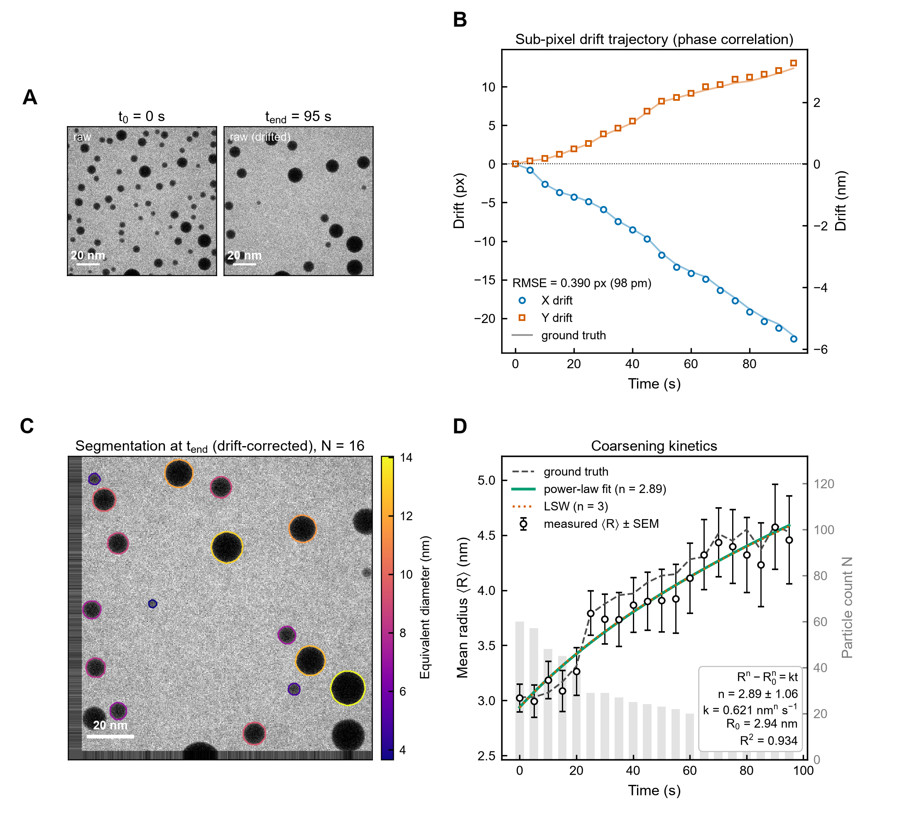

# insitu-tem-dynamics-quant

**Simulation, sub-pixel drift registration and quantitative kinetics analysis of in-situ TEM nanoparticle coarsening sequences.**

In-situ transmission electron microscopy (TEM) records how nanoparticles nucleate, grow, migrate and dissolve under heating, liquid-cell or gas environments. Extracting reliable kinetics from these movies is difficult: frames are noisy because of the low electron dose, the specimen drifts thermally from frame to frame, and neighbouring particles often touch. This repository provides a compact, end-to-end reference pipeline. It generates a physically motivated synthetic in-situ series with known ground truth, corrects the drift with sub-pixel accuracy, segments and measures every particle, and fits a power-law coarsening model to the mean-radius evolution.



*Figure: (A) raw first and last frames with scale bars; (B) phase-correlation drift trajectory compared with the ground truth; (C) watershed segmentation contours of the drift-corrected final frame, coloured by equivalent diameter; (D) mean radius evolution, particle count and power-law kinetic fit.*

---

## Key features

- **Physics-based synthetic data** (`src/simulator.py`)
  - Mean-field Lifshitz–Slyozov–Wagner (LSW) Ostwald ripening, `dr/dt = K/r · (1/⟨r⟩ − 1/r)`, which conserves total volume: large particles grow while small ones shrink and dissolve.
  - Bright-field mass–thickness contrast of projected spheres on a static amorphous-carbon support texture, blurred by a Gaussian PSF.
  - Persistent random-walk thermal drift (10–30 px cumulative), applied with sub-pixel spline interpolation.
  - Low-dose Poisson shot noise plus Gaussian read noise, frame-to-frame dose (brightness) fluctuations and a slowly wandering, non-uniform illumination.
  - Writes an ImageJ-compatible multi-frame TIFF with spatial calibration, plus a ground-truth CSV containing the true drift and true mean particle size.
- **Sub-pixel drift registration** (`src/registration.py`)
  - Band-pass filtering and Hann windowing, then `skimage.registration.phase_cross_correlation` with DFT upsampling (default precision 1/50 px). Every frame is registered against frame 0.
  - Spline-based alignment, a common valid-area mask and a frame-by-frame comparison of the estimated and true drift.
- **Particle quantification** (`src/quantifier.py`)
  - Illumination flattening (morphological closing), fast non-local-means denoising, joint global (Otsu) and local adaptive thresholding.
  - Distance-transform watershed with h-maxima seeds to split touching particles. Particles cut by the valid-area border are excluded.
  - Per-particle area, equivalent diameter (nm), circularity and eccentricity, plus per-frame statistics.
  - Kinetic fit of `R(t)^n − R0^n = k·t`, with a free exponent `n` and with the LSW reference `n = 3`.
- **Publication-style figure** (`src/visualizer.py`): a 2 × 2 summary panel at 300 dpi using a colour-blind-safe palette and built-in scale bars.

## Repository layout

```
insitu-tem-dynamics-quant/
├── main.py                      # one-command pipeline entry point (CLI)
├── requirements.txt             # minimal dependencies
├── src/
│   ├── __init__.py
│   ├── simulator.py             # synthetic in-situ TEM series + ground truth
│   ├── registration.py          # sub-pixel phase-correlation drift correction
│   ├── quantifier.py            # denoising, segmentation, watershed, kinetics fit
│   └── visualizer.py            # 2x2 publication-style summary figure
├── data/
│   ├── synthetic_insitu_stack.tif   # example series (20 x 512 x 512, uint16, 0.25 nm/px)
│   └── ground_truth.csv             # true drift and true mean particle size per frame
└── results/
    ├── insitu_quant_summary.png     # summary figure
    ├── drift_trajectory.csv         # estimated vs. true drift, per-frame error
    ├── frame_statistics.csv         # N, mean/std diameter, mean radius, circularity
    ├── particle_measurements.csv    # per-particle morphology for every frame
    └── kinetics_fit.json            # power-law fit parameters (free n, n = 3, ground truth)
```

## Quick start

```bash
# 1. Clone the repository
git clone https://github.com/<your-account>/insitu-tem-dynamics-quant.git
cd insitu-tem-dynamics-quant

# 2. Install dependencies (Python >= 3.9; a virtual environment is recommended)
pip install -r requirements.txt

# 3. Run the full pipeline
python main.py
```

Running the pipeline regenerates `data/synthetic_insitu_stack.tif`, `data/ground_truth.csv` and everything in `results/`. With the default seed, the output is reproducible.

### Command-line options

| Option | Default | Description |
| --- | --- | --- |
| `--frames` | 20 | Number of frames |
| `--size` | 512 | Image size (px, square) |
| `--pixel-size` | 0.25 | Pixel size (nm/px) |
| `--frame-interval` | 5.0 | Time between frames (s) |
| `--n-particles` | 95 | Initial number of particles |
| `--dose` | 40 | Electron dose per pixel per frame |
| `--seed` | 42 | Random seed |
| `--upsample` | 50 | Phase-correlation upsampling factor |
| `--skip-simulation` | off | Analyse the existing TIFF in `data/` instead of simulating |

To analyse your own experimental series, save it as a `(T, Y, X)` multi-frame TIFF at `data/synthetic_insitu_stack.tif` (or adapt the path in `main.py`). Then run `python main.py --skip-simulation --pixel-size <nm/px> --frame-interval <s>`. Without a ground-truth CSV, the comparison overlays are omitted.

## Conventions and notes

- Drift `(dx, dy)` is the displacement of the specimen in frame *k* relative to frame 0, in image coordinates (x to the right, y downwards). The correction actually applied is `(row, col) = (−dy, −dx)`.
- Particle size is reported as the area-equivalent diameter (`D = 2·sqrt(A/π)`). Circularity is `4πA/P²`.
- The ground-truth radius counts only particles that lie entirely inside the field of view. Very small particles (below roughly 0.6 nm radius) are near the detection limit, so the measured mean radius can be slightly biased upward at early times.
- Fitting the exponent `n` from a short series is intrinsically ill-conditioned. For a mechanistic interpretation, compare the free-`n` fit with the fixed-`n` fits (`kinetics_fit.json`).

## Citation

If this code is useful in your work, please cite the repository URL. Please also cite the original works for the methods used: Guizar-Sicairos *et al.*, *Opt. Lett.* **33**, 156 (2008), for sub-pixel image registration, and Lifshitz & Slyozov (1961) and Wagner (1961) for coarsening theory.
